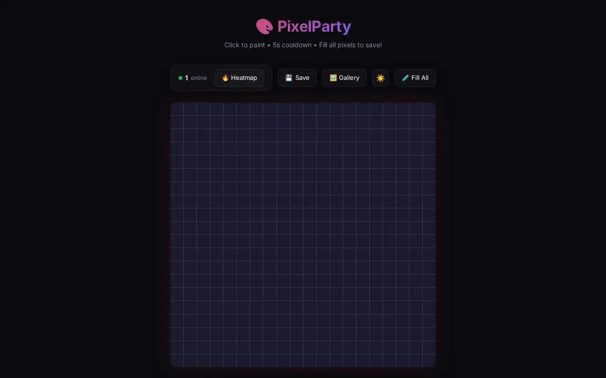

# PixelParty

A shared 20×20 pixel canvas that people paint together in real time, a small take on r/place.

**UI demo — backend offline:** [pixel-party-tau.vercel.app](https://pixel-party-tau.vercel.app). The page loads, but the Supabase project behind it no longer exists, so painting and the gallery don't work. To try it, run it against your own Supabase project (below).



## Features

- Paint changes reach everyone at once through Supabase Realtime
- Other people's cursors show on the grid through Realtime Presence, with an online count
- 5-second cooldown between paints, with a countdown ring
- Palette plus a custom color picker
- Heatmap mode that shades pixels by how often they have been repainted
- When all 400 pixels are filled, a 60-second countdown starts; then the canvas is saved to the gallery and cleared
- Gallery of saved canvases, each downloadable as PNG or SVG; the current canvas exports the same way
- Dark and light theme, remembered in `localStorage`
- A "Fill All" test button that fills the grid so you can try the save-and-reset flow (it is visible to every visitor)

## Stack

- [Nuxt 4](https://nuxt.com) (Vue 3, TypeScript) with [Tailwind CSS](https://tailwindcss.com)
- [Supabase](https://supabase.com): Postgres and Realtime, through `@nuxtjs/supabase`
- Hosted on [Vercel](https://vercel.com)

## Project structure

```
pixel-party/
├── app/
│   ├── pages/index.vue
│   ├── components/
│   │   ├── canvas/          # PixelGrid, PixelCell
│   │   └── ui/              # color picker, cooldown, export, gallery, theme, stats
│   └── composables/         # usePixelCanvas, usePresence, useCooldown, useCanvasReset, useTheme
└── supabase/migrations/     # SQL for the pixels and canvas_history tables
```

## Run locally

You need Node.js and a Supabase project.

1. Create a project at [supabase.com](https://supabase.com).
2. In the Supabase SQL editor, run `supabase/migrations/001_initial_schema.sql`. It creates the `pixels` table, fills it with the 400 grid cells, creates `canvas_history` for the gallery, adds both tables to the `supabase_realtime` publication, and sets the public read and write policies.
   - Skip `002_add_gallery.sql` on a new project. It only adds `canvas_history` to databases made before 001 included it, and running it after 001 fails.
3. Copy `.env.example` to `.env` and set:
   - `SUPABASE_URL`: the project URL
   - `SUPABASE_KEY`: the project's anon (public) key
4. Start the app:

```sh
npm install
npm run dev       # http://localhost:3000
npm run build     # production build
```

## Deploy

Deploy it like any Nuxt app (it runs on Vercel now). Set `SUPABASE_URL` and `SUPABASE_KEY` in the host's environment variables.

## License

[MIT](LICENSE)
